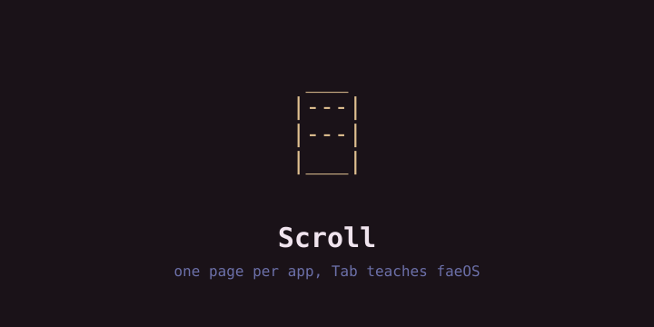
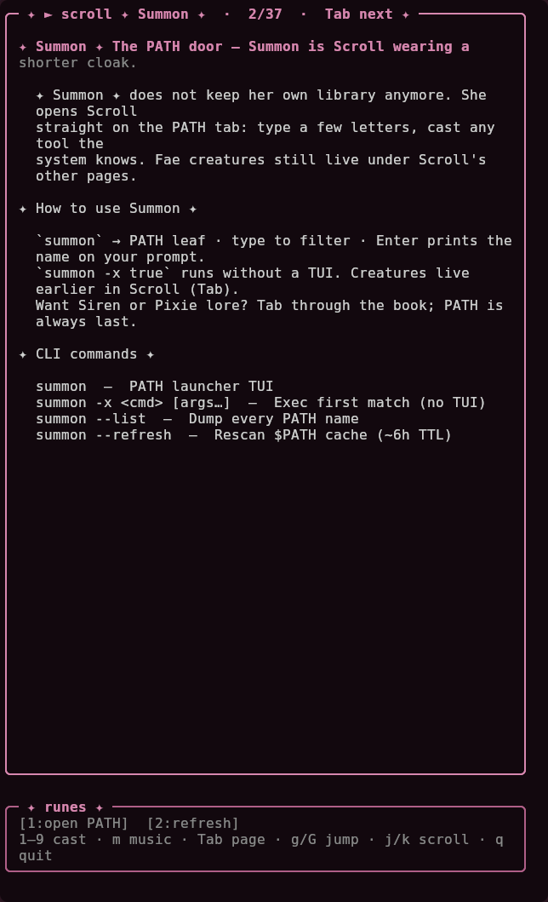
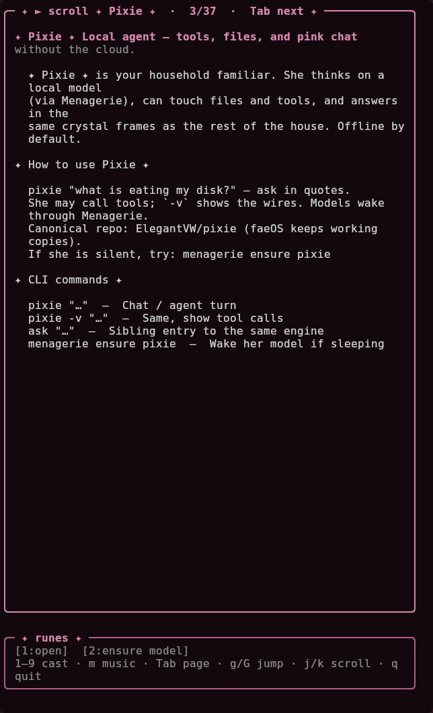

# Scroll — living book 📜



> **one page per app, Tab teaches faeOS — the last leaf opens PATH**

Scroll is how the house teaches itself. Each page is one creature: who she
is, how to live with her (keys included), which spells to type, and footer
runes that cast her. The last leaf is PATH — every tool on `$PATH`, printed
to your prompt so you may finish the line yourself.

Runs from a faeOS checkout: shared house libs (`fae_termart`, `fae_egg`,
`fae_ambience`) live in faeOS `bin/` — faeOS keeps only a thin launcher.

For: faeOS onboarding, one page per app. Not for: standalone use outside faeOS.

## Look




```
 ___
|---|
|---|
|___|
```

## Status

**It runs.** `scroll` opens the book, `scroll --path` (`summon`) opens the
PATH leaf, `scroll list` dumps every page as text. 35 static pages plus the
egg leaf (sealed `hermetic` — or `kur` once hatched) and the virtual PATH
leaf: 37 leaves, Tab order.

Authoring rule: new shipped app ⇒ add an `AppPage` in `scroll_pages.py`
before calling it done.

## Use

```bash
scroll              # open the book on page one
scroll --path       # PATH leaf (same as summon)
scroll list         # every page as text (for grepping)
summon              # PATH leaf short name
summon -x <cmd>     # run a PATH match without the TUI
```

Keys: `Tab` / `Shift-Tab` pages · `1–9` runes · `j/k` scroll · `g`/`G` jumps ·
`m` ambience · `q` quit

## Build

No build — Python 3, stdlib only, needs a faeOS `bin/` beside it (or on
`~/bin`) for the house libs.

```bash
python3 -m pytest tests/ -q
SCROLL_BIN=~/scroll/scroll scroll   # via the faeOS thin launcher
```

## License

MIT — see [LICENSE](LICENSE).
